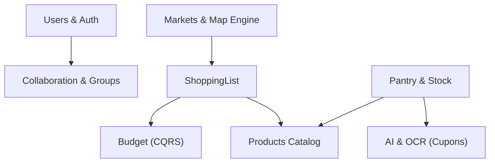
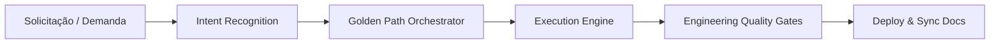

# BRSmartList — Engineering & Architecture Showcase

[](#arquitetura-do-sistema)
[](https://laravel.com)
[](https://reactnative.dev)
[](https://www.typescriptlang.org)
[](https://php.net)
[](#engineering-operating-system-eos)

> **Nota de Confidencialidade & Portfólio:** Este repositório é um **Showcase Arquitetural e de Engenharia**. Ele apresenta a visão do sistema, os padrões de design, o modelo de governança e os contratos públicos de API do projeto **BRSmartList**. Por razões de propriedade intelectual e conformidade de segurança, o código-fonte proprietário com as regras de negócio concretas é mantido em repositório privado.

---

## 📌 Sumário
- [1. Visão do Produto](#1-visão-do-produto)
- [2. Destaques de Engenharia](#2-destaques-de-engenharia)
- [3. Arquitetura do Sistema](#3-arquitetura-do-sistema)
  - [3.1 Clean Architecture & Camadas](#31-clean-architecture--camadas)
  - [3.2 Bounded Contexts (DDD)](#32-bounded-contexts-ddd)
  - [3.3 Arquitetura Frontend (Mobile)](#33-arquitetura-frontend-mobile)
- [4. Engineering Operating System (EOS)](#4-engineering-operating-system-eos)
  - [4.1 Golden Paths & Intent Recognition](#41-golden-paths--intent-recognition)
  - [4.2 Engineering Quality Gates (EQG)](#42-engineering-quality-gates-eqg)
- [5. Stack Tecnológica](#5-stack-tecnológica)
- [6. Padrões de Código e Exemplos Abstratos](#6-padrões-de-código-e-exemplos-abstratos)
- [7. Infraestrutura & Resiliência](#7-infraestrutura--resiliência)
- [8. Contato & Acesso sob Demanda](#8-contato--acesso-sob-demanda)

---

## 1. Visão do Produto

O **BRSmartList** é uma plataforma inteligente e resiliente voltada para o gerenciamento de compras domésticas, controle orçamentário e despensa automatizada.

O projeto foi concebido para resolver fricções complexas do dia a dia:
* **Gerenciamento Inteligente de Listas:** Organização por corredores/grupos, processamento em lote e modo *In-Store* otimizado para navegação rápida no supermercado.
* **Orçamento Write-Through Consistente:** Atualização em tempo real de limites e projeções financeiras durante a compra.
* **Despensa Automatizada & QuickScan:** Alertas de validade e reposição inteligente via leitura de código de barras e OCR de cupons fiscais.
* **Catálogo Canônico Multiatributo:** Consolidação de produtos a partir de 4 bases distintas (OFF, OPF, OBF, OPFF).
* **Mecanismo de Mapas & Preços:** Mapeamento geográfico via motor nativo próprio (Leaflet/OSM) sem lock-in com provedores proprietários.

---

## 2. Destaques de Engenharia

O diferencial do projeto não reside apenas nas suas funcionalidades, mas na **maturidade de engenharia de software aplicada**:

* **Domain-Driven Design (DDD):** Domínio isolado e puro, com entidades ricas, Value Objects imutáveis e isolamento rigoroso de regras de negócio.
* **Clean Architecture com Dependência Centrípeta:** A infraestrutura e frameworks dependem dos Use Cases e do Domínio, nunca o contrário.
* **Governança de Engenharia Baseada em Constituição:** O projeto opera sob uma Constituição Técnica e princípios documentados que regem desde decisões de arquitetura até o trabalho assistido por agentes de IA.
* **Dual Architecture:** Toda entrega equilibra a *Technical Architecture* (manutenibilidade, isolamento e contratos) com a *Experience Architecture* (jornada intuitiva do usuário e baixa carga cognitiva).
* **Hard Gates Automatizados:** CI/CD com barreiras rigorosas de qualidade estática (Larastan, Hard Gate de TypeScript, PHPUnit e Jest/RNTL).

---

## 3. Arquitetura do Sistema

### 3.1 Clean Architecture & Camadas

O backend é organizado em quatro círculos concêntricos rigorosos:

```
┌────────────────────────────────────────────────────────┐
│  Presentation Layer                                    │
│  Controllers, FormRequests, API Resources, OpenAPI     │
│  ┌──────────────────────────────────────────────────┐  │
│  │  Application Layer                               │  │
│  │  Use Cases, Input/Output DTOs, Handlers          │  │
│  │  ┌────────────────────────────────────────────┐  │  │
│  │  │  Domain Layer                              │  │  │
│  │  │  Entities, Value Objects, Domain Services, │  │  │
│  │  │  Domain Events, Repository Interfaces      │  │  │
│  │  └────────────────────────────────────────────┘  │  │
│  │                                                  │  │
│  └──────────────────────────────────────────────────┘  │
│  Infrastructure Layer (Concreto)                       │
│  Eloquent Implementations, Redis, Storage, Mail, APIs  │
└────────────────────────────────────────────────────────┘
```

**Regras Inegociáveis:**
1. O **Domain** não possui nenhuma dependência do Laravel ou de ORM (zero dependência de framework).
2. **Controllers** atuam exclusivamente como adaptadores de entrada (validação de schema e delegação para Use Cases).
3. Eloquent é restrito à camada de **Infrastructure** como detalhe de persistência.

### 3.2 Bounded Contexts (DDD)

O sistema é particionado em contextos delimitados de alta coesão e baixo acoplamento:



* **ShoppingList:** Gestão transacional de listas, ordenação por layout de loja e checkout.
* **Budget:** Gestão orçamentária orientada a eventos e CQRS com consistência write-through.
* **Pantry:** Controle de estoque doméstico com consumo automático e gatilhos de reposição.
* **Products:** Motor canônico de normalização de código de barras e deduplicação de catálogo.
* **Markets & Prices:** Crowdsourcing de preços e renderização de mapas vetoriais locais.

### 3.3 Arquitetura Frontend (Mobile)

O aplicativo mobile utiliza **React Native** com **Expo** e segue o padrão **MVVM (Model-View-ViewModel)** com **Zustand**:

```
Views / Screens (React Native Components)
       ↓ (consome estado e ações)
ViewModels / Stores (Zustand)
       ↓ (orquestra chamadas e mapeamentos)
Repositories & Data Sources (Axios com Fila de Refresh Token e Backoff)
       ↓ (contratos validados)
Backend REST API (OpenAPI 3.1)
```

---

## 4. Engineering Operating System (EOS)

O **BRSmartList** opera sobre um sistema operacional de engenharia próprio, que guia tanto os engenheiros de software quanto os agentes de IA autônomos.



### 4.1 Golden Paths & Intent Recognition
Toda tarefa passa por um reconhecimento de intenção automatizado que seleciona um dos **Golden Paths**:
- **Feature Golden Path:** Descoberta → Arquitetura → Contratos → Implementação → Testes → Documentação.
- **Refactoring Golden Path:** Auditoria → Diagnóstico → Preservação de Contratos → Migração Incremental (Strangler Fig).
- **Architecture Golden Path:** Elaboração de ADR → Architecture Gate → Validação de Limites.

### 4.2 Engineering Quality Gates (EQG)
Nenhuma alteração é aceita sem passar pelos gates automáticos de pipeline:
- **EQG-01 (Contract Gate):** Validação de conformidade com schemas OpenAPI 3.1.
- **EQG-02 (Architecture Gate):** Verificação de dependências de camadas (sem vazamento de infraestrutura).
- **EQG-03 (Static Analysis Gate):** Larastan (PHPStan) no nível máximo e TypeScript Strict sem bypasses (`any` proibido).
- **EQG-04 (Testing Gate):** Cobertura de testes unitários e de integração (PHPUnit + Jest).

---

## 5. Stack Tecnológica

| Camada | Tecnologia | Função Principal |
|---|---|---|
| **Backend Core** | PHP 8.3+, Laravel 13 | Runtime de API e injeção de dependências |
| **Banco de Dados** | MySQL 8.4 | Persistência relacional com índices otimizados |
| **Cache & Filas** | Redis 7 | Locks distribuídos, pub/sub e fila assíncrona |
| **Mobile App** | React Native 0.86, Expo 57, React 19 | Interface multiplataforma nativa |
| **State Management** | Zustand 5.0 | MVVM ViewModels de alto desempenho |
| **Mapas** | Leaflet + OpenStreetMap (WebView nativa) | Motor de visualização de mapas desacoplado |
| **Segurança & Auth** | JWT com Refresh Tokens + Biometria nativa | Autenticação stateless e segura |
| **CI/CD & Qualidade**| GitHub Actions, Pint, Larastan, Jest, PHPUnit | Pipeline com Hard Quality Gates |
| **Infraestrutura** | Docker, Nginx Host Nativo, VPS Linux, Rclone Crypt | Ambientes segregados com backups criptografados |

---

## 6. Padrões de Código e Exemplos Abstratos

Para exemplificar a adesão estrita aos padrões arquiteturais, veja abaixo a abstração de um caso de uso e contrato de repositório:

### Contrato de Repositório no Domínio (Independente de ORM)
```php
namespace Domain\ShoppingList\Repositories;

use Domain\ShoppingList\Entities\ShoppingList;
use Domain\ShoppingList\ValueObjects\ListId;

interface ShoppingListRepositoryInterface
{
    public function findById(ListId $id): ?ShoppingList;
    
    public function save(ShoppingList $list): void;
    
    public function delete(ListId $id): void;
}
```

### Caso de Uso na Camada de Aplicação (Clean Architecture)
```php
namespace Application\ShoppingList\UseCases;

use Domain\ShoppingList\Repositories\ShoppingListRepositoryInterface;
use Application\ShoppingList\DTOs\AddItemInput;
use Application\ShoppingList\DTOs\AddItemOutput;

readonly class AddItemToShoppingListUseCase
{
    public function __construct(
        private ShoppingListRepositoryInterface $repository
    ) {}

    public function execute(AddItemInput $input): AddItemOutput
    {
        $list = $this->repository->findById($input->listId);
        
        if (!$list) {
            throw new ShoppingListNotFoundException($input->listId);
        }

        // Regra de negócio executada na própria Entidade de Domínio
        $list->addItem($input->item);

        $this->repository->save($list);

        return AddItemOutput::fromEntity($list);
    }
}
```

---

## 7. Infraestrutura & Resiliência

* **Deploy Contínuo com Zero-Downtime:** Pipeline automatizada via GitHub Actions executando runners dedicados com isolamento de ambiente.
* **Segurança e Criptografia:** Rotinas de backup automatizadas sincronizadas para storage off-site com criptografia ponta a ponta (`rclone crypt`).
* **Proteção contra N+1 e Gargalos:** Strict eager loading monitorado e locks distribuídos em operações concorrentes de estoque e orçamento.

---

## 8. Contato & Acesso sob Demanda

Caso deseje avaliar o código-fonte proprietário completo, testes em execução ou agendar uma conversa técnica:

- **Desenvolvedor:** Giuliano Estigarraga Silveira
- **LinkedIn:** [linkedin.com/in/giuliano-estigarraga-silveira-39876a175](https://www.linkedin.com/in/giuliano-estigarraga-silveira-39876a175/)
- **Repositório Privado:** Acesso de leitura temporário pode ser concedido sob solicitação para recrutadores e avaliadores técnicos.
