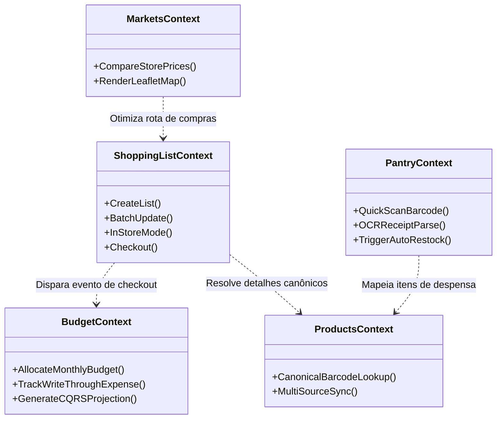

# Arquitetura e Engenharia do BRSmartList

Este documento sintetiza as decisões fundamentais e a topologia arquitetural do **BRSmartList**.

---

## 1. Princípios Arquiteturais Fundamentais

Conforme a Constituição Arquitetural do projeto:

1. **Domain First:** A regra de negócio reside exclusivamente no Domínio e não possui acoplamento com o framework web (Laravel) ou mecanismos de persistência (Eloquent).
2. **Clean Architecture (Camadas Concêntricas):**
   - **Presentation:** Adaptadores HTTP, Controllers REST, validação de payload com Form Requests e recursos OpenAPI.
   - **Application:** Orquestração de casos de uso (Use Cases) e DTOs.
   - **Domain:** Entidades ricas, Value Objects, eventos de domínio e interfaces abstratas de repositório.
   - **Infrastructure:** Conexões concretas com MySQL, Redis, integrações de APIs externas e repositórios Eloquent.
3. **Contract First Engineering:** Todo endpoint possui contrato formal OpenAPI 3.1. Nenhuma alteração é aceita sem validação de impacto contratual.
4. **Dual Architecture:** Toda funcionalidade é balanceada entre a arquitetura técnica interna e a experiência fluida do usuário final (Beginner First).

---

## 2. Topologia dos Bounded Contexts

O projeto adota Domain-Driven Design com módulos delimitados:

---

## 3. Engineering Quality Gates (EQG)

A pipeline de integração contínua (CI/CD) rejeita automaticamente qualquer alteração que não atinja os requisitos mínimos de qualidade:

| Gate | Verificação | Ferramental |
|---|---|---|
| **EQG-01** | Conformidade de Contratos | OpenAPI 3.1 Schemas |
| **EQG-02** | Isolamento de Camadas | Larastan / Deptrac rules |
| **EQG-03** | Análise Estática Rigorosa | PHPStan / Larastan (Max Level) |
| **EQG-04** | Tipagem Estática Front-end | TypeScript Strict Mode (Zero `any`) |
| **EQG-05** | Testes Unitários & Feature | PHPUnit (Backend) + Jest (Mobile) |
| **EQG-06** | Segurança de Dependências | Composer Audit + NPM Audit |

---

## 4. Filosofia de Evolução: Strangler Fig Pattern

Para mitigar os riscos inerentes a grandes reescritas, qualquer modernização ou refatoração no BRSmartList é conduzida incrementalmente:
- Coexistência segura entre código legado e novas camadas limpas.
- Redirecionamento gradual de tráfego módulo por módulo.
- Preservação incondicional da compatibilidade com o aplicativo mobile em produção.
